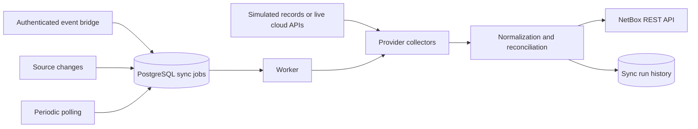

# Live collection and automatic synchronization

The default `SOURCE_MODE=simulation` reads persistent simulated source records. Create, edit, and delete operations insert a durable sync job in the same PostgreSQL transaction. `npm run worker` processes those jobs and periodically queues full-scope polling. A complete snapshot goes through the existing preview/apply reconciliation directly into NetBox. Manual preview/apply remains available. A failed or partial collection never means an empty inventory; it skips changes for that scope.



## Setup and modes

Set distinct random `SYNC_WORKER_SECRET` and `EVENT_INGEST_SECRET` values of at least 24 characters in `.env`. Apply migrations, start NetBox, then start the app (`npm run dev`) and worker (`npm run worker`). The worker endpoint defaults to `http://localhost:3000/api/sync/worker`; override with `SYNC_WORKER_URL` for another local port. `SYNC_POLL_SECONDS` defaults to 300 and accepts 10–86400. `SYNC_WORKER_INTERVAL_MS` defaults to 2000. The worker must be running for automatic sync; pending jobs persist across restarts. Five failed attempts mark a job `dead`; the error remains visible in **Run history**. A later poll or source change queues a fresh attempt. Duplicate event IDs within a scope return the same job. Jobs retry with bounded backoff. NetBox outages leave inventory unavailable and never cause a local fallback write.

Switch to `SOURCE_MODE=live` and restart the app and worker to discover real sources. Source editing and simulation outage controls are disabled. **Do not switch modes on an inventory already populated from simulation unless the live scopes represent the same identities**: a successful empty live snapshot can mark simulated records missing. Use a fresh database or distinct scopes for real onboarding. No live collector provisions or changes infrastructure. Live previews re-collect at apply and reject changed snapshots. Unavailable credentials/API errors fail that scope; they do not produce a successful empty snapshot.

`LIVE_SCOPE_CONFIG_JSON` is a JSON object keyed by the UUIDs returned by authenticated `GET /api/providers`. Configure each enabled scope; omitted scopes fail collection visibly. Example:

```json
{
  "aws-scope-uuid": { "region": "us-east-1" },
  "azure-scope-uuid": { "subscriptionId": "subscription-uuid" },
  "gcp-scope-uuid": { "projectId": "project-id" },
  "vmware-scope-uuid": { "url": "https://vcenter.example" },
  "proxmox-scope-uuid": { "url": "https://pve.example:8006", "node": "optional-node" }
}
```

| Provider | Collector and credentials | External event configuration |
| --- | --- | --- |
| AWS | SDK v3 EC2 `DescribeInstances` with pagination. Set a region in scope config and grant read-only `ec2:DescribeInstances` through the SDK default credential chain. | Route EC2 state events and relevant CloudTrail create/update/delete API events from EventBridge through an authenticated bridge to this app. [AWS events](https://docs.aws.amazon.com/eventbridge/latest/ref/events-ref-ec2.html). |
| Azure | ARM subscription VM `List All` with continuation links. Use `AZURE_TENANT_ID`, `AZURE_CLIENT_ID`, `AZURE_CLIENT_SECRET` or another `DefaultAzureCredential` source; grant VM Reader. | Use Event Grid subscription/resource-group write/delete events, filter to `Microsoft.Compute/virtualMachines`, and bridge to this app. [Azure event schema](https://learn.microsoft.com/en-us/azure/event-grid/event-schema-subscriptions). |
| GCP | Compute Engine `instances.aggregatedList` with pagination via Application Default Credentials. Set `GOOGLE_APPLICATION_CREDENTIALS` or workload identity and grant `compute.instances.list`. | Export Compute audit events to a Pub/Sub/Eventarc bridge. Periodic polling catches events that do not represent inventory changes. [GCP list API](https://cloud.google.com/compute/docs/instances/get-list). |
| VMware | vCenter REST `GET /api/vcenter/vm` using HTTPS session authentication; set `VMWARE_USERNAME` and `VMWARE_PASSWORD` for a read-only account. | A site-specific vCenter event relay can call the event endpoint; polling is the baseline. vCenter list responses can be limited on large deployments, so validate scope sizing before production. [vSphere VM list](https://developer.broadcom.com/xapis/vsphere-automation-api/latest/api/vcenter/vm/get/). |
| Proxmox | `GET /api2/json/cluster/resources?type=vm` over verified HTTPS. Set `PROXMOX_TOKEN_ID` and `PROXMOX_TOKEN_SECRET` with audit-only rights. | A site-specific event relay can call the event endpoint; polling is the baseline. [Proxmox API](https://pve.proxmox.com/wiki/Proxmox_VE_API). |

The initial live mapping collects fields available in each list response. Some platforms need extra detail or network calls for accurate IP, CPU, memory, or power state; unavailable fields remain null/unknown. For VMware and Proxmox, use trusted TLS certificates. The vCenter list endpoint has a documented result limit; large deployments need a scoped collector extension before use.

## Event bridge contract

`POST /api/sync/events` accepts `Authorization: Bearer <EVENT_INGEST_SECRET>` and JSON `{"scopeId":"<uuid>","eventId":"<provider-event-id>"}`. Return `202` acknowledges the durable queue insert. Events trigger a **full provider snapshot**, so untrusted event payload fields cannot directly mutate inventory. The cloud-side bridge must authenticate its upstream events, map the event to the configured scope, preserve a stable event ID for deduplication, and send this compact contract. The app does not directly subscribe to EventBridge, Event Grid, Pub/Sub, vCenter, or Proxmox. Keep this endpoint behind a private network or gateway with TLS; do not expose the bearer secret in a URL or client UI.

## Validation status

Use `node tests/http/automatic-sync.mjs` with the app, worker, PostgreSQL, and real NetBox running to verify automatic create/update/orphan, event deduplication, polling, and the absence of local inventory writes. `node tests/http/failure-sync.mjs` checks failed simulated collections and recovery. `node tests/http/netbox-outage.mjs` temporarily stops this project's NetBox web container to verify unavailable inventory, safe retry, and recovery. A separate local server in Live Mode previously returned a failed scope preview for missing configuration and rejected source writes with `LIVE_READ_ONLY`. Mocked unit tests cover each live collector mapping and missing configuration/error behavior. **No real AWS, Azure, GCP, VMware, or Proxmox connection has been validated**; credential permissions, provider version compatibility, and cloud event infrastructure require testing in the target environment.
